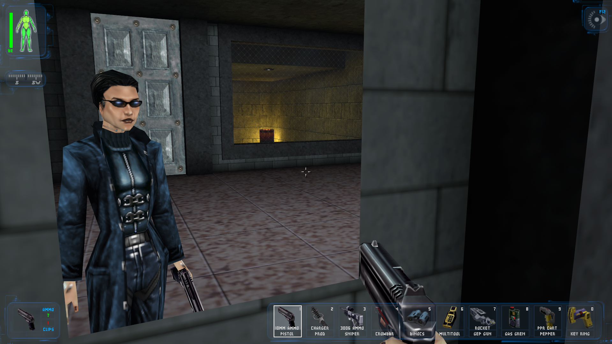

# DX RUST

**The original Deus Ex, rebuilt in Rust on the Bevy engine and played with your own copy of the game.**

DX RUST is a from-scratch reimplementation of *Deus Ex* (Ion Storm, 2000). It reads the game's own maps, textures,
sounds, music, conversations and class defaults straight from your install, and reproduces the original's gameplay
one-to-one:

- every mission, the three endings and the credits;
- AI, combat, stealth, skills, augmentations, inventory;
- conversations, infolinks, computers, keypads;
- saves and the original menus and HUD.

It runs as a native Windows program and on Steam Deck / Linux, with no old engine underneath.

> **You need your own copy of Deus Ex** (Game of the Year Edition from Steam or GOG). No game files are included
> here or in the releases.

## Features
- **The whole game.** Every map of every mission (the game has 83 map files), every mission script, scripted set pieces and both training courses. Travel
  between maps keeps the state of hub maps, and the next map is read ahead.
- **Faithful by default.** The original rules, numbers and quirks, checked against the original scripts. Every
  modern change is an optional switch in *Settings > Enhancements*.
- **Modern engine underneath.**
  - A fixed-timestep simulation, so play is the same at any frame rate.
  - Resolution-independent, crisp UI.
  - No sound-channel limits.
  - Fast loading.
- **Controller support.**
  - Full gamepad play, with modern-shooter defaults that you can remap.
  - A radial aug wheel and D-pad aug pages.
  - Xbox and PlayStation button glyphs, and snap-to navigation in the menus.
- **DualSense.** Health on the light bar, adaptive triggers for each weapon class, and rumble. Over USB, also HD
  haptics and infolinks through the pad's speaker.
- **Mod support.** Point the launcher's *Mods* page at the folders of the community mods you have, and turn on as
  many as you like (see below):
  - the **Lay D Denton Project** (play as the female JC, with her voice, looks and conversations);
  - **HDTP** (high-definition models) and **New Vision** (high-resolution world textures), each with a switch in
    Settings;
  - **Visible Attachments** (scopes, lasers and silencers drawn on the weapons);
  - **Augmentique** (outfits for JC and the people of the world, and weapon skins);
  - **GMDX: Augmented Edition** (perks bought with skill points on the Skills screen, and its fixes and
    quality-of-life options);
  - **Helios** texture packs (repainted characters, items and world);
  - **Precipitation** (rain sounds and weather for the rain enhancement).
- **Classic / Modern in one key.** Press **Tab** in play and the screen wipes between the original look and a
  modern one, like the graphics switch in some remasters. Modern turns on every enhancement below at once and puts
  back your own mix the next time; Classic is the game as it shipped.
- **A modern look (all optional):**
  - real-time shadows from the map's own lights, ambient occlusion, soft shadows and bloom;
  - rain with splashes, ripples and lightning storms (with the Precipitation mod's sounds), volumetric night
    clouds and rolling fog, light shafts and haze;
  - modern water with waves, reflections and an open sea, mirrors that reflect JC;
  - a photographic city skyline, light halos and modern coronas, a modern night-vision view;
  - Helios repaints and HD textures, and enhanced particle effects, barrel smoke and bullet impacts;
  - **skeletal characters**: the Machine God team's rebuilt human bodies on a real skeleton, in the original skins,
    with blended moves and faces that lip-sync, blink and glance around; JC's own body in mirrors, third person and
    under the view in first person;
  - **ragdolls** (Avian physics) for the killed and knocked out, fluid blood (droplets, runs down walls, pools
    under the dead, bloodier gibs), wound marks, hurt poses and limps, coat cloth and wet bodies in the rain.
- **Modern play (all optional):**
  - Modern Aiming: the aim sways within the accuracy cone (wide when untrained, steady when you master the
    weapon or hold still) and the crosshair and gun follow it, with aim-down-sights on guns;
  - a third-person camera (free orbit or over the shoulder), mantling, carried objects as cover, ladder grabbing;
  - Smarter AI (GMDX's tougher guards, sharper senses, suppressive fire, guards who call out and check on
    disturbances) with optional alert markers over their heads;
  - elements (shocks in water, spreading fire), bullet penetration, melee arcs, thrown-object noise and body
    alarms;
  - terminals and keypads used in the world: the camera moves in to the screen and you click on it;
  - diegetic healing: hold a medkit, look at the limb to treat and use it there; aug glows on JC's body;
  - better audio: smoother mixing, sound through walls, room reverb and a distant soundscape.
- **Achievements.** Fifty achievements in the style of the *Remastered* list, with their own page in the
  persona screens and an unlock notice in play.
- **Smooth lip sync.** Mouths blend between sounds and close gently, and people blink visibly. The timings follow
  Joe Wintergreen's lipsync mod, and there's a switch in Enhancements to turn it off.
- **Optional extras:**
  - dialogue hotkeys and Discord Rich Presence;
  - inventory auto-sort;
  - keypad codes and logins taken from your notes;
  - using consumables straight from the floor;
  - ladder grabbing;
  - enemies that run out of ammo;
  - casings and blood that stay;
  - a debug menu with the original cheats.

  Every setting, the original ones included, is on one searchable list.
- **Rotating autosaves** on map changes and completed goals.

## Getting started

### Windows
1. Install Deus Ex (Steam or GOG).
2. Download `dxrust-windows.zip` from [Releases](../../releases) and unzip it anywhere.
3. Run **dxlauncher.exe**. It looks for the Deus Ex folder on its own; if it can't find it, click *Game Folder...*.
4. Choose a display mode and resolution, then click **Play**.

### Steam Deck / Linux
1. Install *Deus Ex: Game of the Year Edition* through Steam. Proton installs the files DX RUST needs, and you
   don't have to run the game.
2. In Desktop Mode, download `dxrust-steamdeck.tar.xz` from [Releases](../../releases) and extract it, for
   example to `~/Games/dxrust`.
3. Run `dxlauncher` once to check that it found your game. Steam libraries and SD cards are searched
   automatically.
4. Add `dxrust.sh` (or `dxlauncher`) to Steam as a *Non-Steam Game* to play from Game Mode. Use Steam Input's
   *Gamepad* template.

### Mods (optional)
1. Download the mods you want and unzip each one into its own folder:
   [Lay D Denton Project](https://www.moddb.com/mods/the-lay-d-denton-project),
   [HDTP](https://www.moddb.com/mods/project-hdtp),
   [New Vision](https://www.moddb.com/mods/deus-ex-new-vision),
   [Augmentique](https://www.moddb.com/mods/augmentique),
   [GMDX](https://www.moddb.com/mods/gmdx) (Augmented Edition), Visible Attachments, Helios and Precipitation.
2. On the launcher's **Mods** page, click a mod's button and choose its folder. Right-click it to turn it off again.
3. For Lay D Denton, start a new game and use the portrait arrows: every other face is the female JC. Tick
   *Original Morpheus?* or *Original Interactions?* if you want the original versions of those.
4. HDTP's models, New Vision's textures and Helios's repaints can be switched on and off in
   *Settings > Enhancements > Mods* (and follow the Classic / Modern switch).

The mods' files stay in their own folders: nothing in your Deus Ex install is changed, and DX RUST includes none
of them. GMDX's own copy of the game code isn't run: its perks are rewritten in Rust and read their names, numbers
and icons from your copy of the mod.

## Building from source
You need Rust (stable) and, on Windows, the Visual Studio C++ build tools.

    cargo build --release -p dxview                                       # the game
    cargo build --release --manifest-path crates/dxlauncher/Cargo.toml    # the launcher
    target/release/dxview "C:\path\to\Deus Ex"                            # or run the launcher

On Windows, `BUILD_RELEASE.bat` makes a shareable `dist\` folder.

| Crate | What it does |
| --- | --- |
| `unreal-pkg` | Reads Unreal Engine 1 packages: names, exports, properties, textures, sounds, meshes, class defaults, mod folders |
| `dx-level` | Builds a map: BSP geometry, lightmaps, collision, actors, navigation, conversations |
| `imsim-core` | Engine-neutral rules: movement physics, flags, inventory, skills |
| `imsim-audio` | A software mixer: positional sounds and tracker music with section jumps |
| `dxview` | The game itself, on Bevy |
| `dxlauncher` | The launcher (egui) |
| `dxtool` | Command-line package inspector |

## Status and what's left
The whole game is implemented. Before 1.0:
- a full playthrough, with fixes for whatever it finds;
- tuning by eye (water, a few intro effects);
- a performance pass;
- Steam Deck tuning;
- save round-trip tests on every map.

Much of the v2.0 list is already in (the Classic / Modern switch, real-time shadows, weather, modern water,
third person, Smarter AI, achievements, skeletal characters, ragdolls and fluid blood). Still to come: remastered
lighting with normal maps, aim and head-turning layered on the skeletal bodies, and multiplayer, among others.
Every item stays optional. The latest performance pass took Modern from about 32 to 47 fps on an RTX 3050.

The full list is in [ROADMAP.md](ROADMAP.md). Bug reports from playthroughs are very welcome: say which map you
were on and what you did.

## Legal
- DX RUST is an unofficial fan project. It isn't affiliated with or endorsed by Eidos, Square Enix, Embracer or
  Ion Storm.
- *Deus Ex* is a trademark of its owners. All game content (maps, art, audio, text) belongs to them and is read
  from your own copy at run time.
- The Lay D Denton Project belongs to its authors and is used with their permission. HDTP, New Vision, Visible
  Attachments, Augmentique, Helios, Precipitation and GMDX belong to their authors. No mod's files are redistributed here.
- The rebuilt human bodies, rig and animations in `assets/rig` are the Machine God team's, included with their
  permission (credit them if you reuse them). They contain no Deus Ex data.
- DX RUST's own source code is licensed under the **GNU GPL v3.0 or later** (see [LICENSE](LICENSE)).

## Credits
- Ion Storm Austin, for Deus Ex.
- The Lay D Denton Project team, for the mod and permission to support it.
- The HDTP team, the New Vision team, the authors of Visible Attachments, Augmentique, Helios, Precipitation and
  GMDX (CyberP, and Sarge and the Augmented Edition team), for their mods.
- The Machine God team, for the rebuilt human bodies, rig and animations behind Skeletal Characters.
- The Bevy, egui, gilrs and hidapi projects, and the Rust community.
